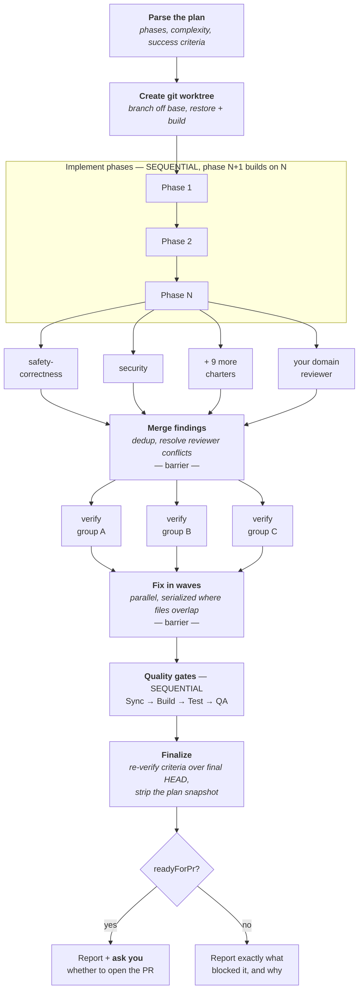
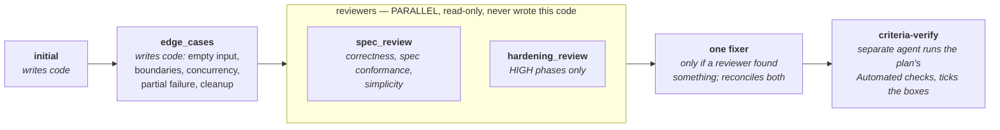

# implement-plan-with-dynamic-workflow

An autonomous, multi-agent implementation pipeline for **Claude Code**.

Give it an approved plan. It creates a git worktree, implements every phase, has each phase
reviewed by an agent that did not write the code, verifies the plan's success criteria with a
separate agent, puts the whole diff in front of a board of ~12 specialist reviewers in
parallel, fixes what they verifiably find, and runs your build/test/QA gates. It reports
whether the branch is worth a PR — and never opens one itself.

Humans gate both ends: you approve the plan going in, you approve the PR coming out.

**Claude Code only.** It is built on Claude Code's dynamic workflows (a `.js` file the CLI runs
in the background, spawning subagents) plus its skills/commands/agents layout. There is no
Cursor or Copilot equivalent here.

**Stack-agnostic.** The orchestrator has no language, framework or cloud specifics in it and is
copied verbatim into every repo. Everything local lives in two files you write once:
`repo-profile.json` (your commands) and `conventions.md` (your rules).

**It is a graph, not a chain.** Most multi-step agent setups end up as a queue — step one, then
step two, each waiting politely for the one before it, because that is the order you thought of
them in. A lot of that waiting buys nothing. What follows is deliberately shaped instead.

**There is a talk.** [`../talk/`](../talk/) holds the 30-minute deck this bundle came out of — the
same argument at length, with the A/B test and the cost measurements behind it. Read it if you want
the reasoning; this README is enough if you just want it running.

---

## How it runs

Two words worth pinning down, because the rest of this README leans on them. A **node** is one
bounded job: one agent, one input, one output. An **edge** is a real dependency — this node's output
*feeds* that node's input. Order alone is not an edge. Neither is "it felt tidier to wait".

**Sequential only where work builds on earlier work. Parallel everywhere else.** The two wide rows
are the review board (one agent per charter) and finding verification (one agent per fix group).



Only two steps are **barriers** — points where everything upstream must finish before anything
downstream starts — and both earn it: merging findings genuinely needs every reviewer's output to
deduplicate across them, and the fix waves need the whole set to work out which groups share files.
Everything else streams.

### The shapes it is built from

You do not invent a topology per task; you recognise which one a task already is. A small number of
shapes cover most of what agent pipelines do, and this one is essentially two of them:

| Named pattern | Where this pipeline uses it |
|---|---|
| **fan-out-and-synthesize** | the review board — 12 reviewers, merged into one set of findings |
| **adversarial verification** | every finding is checked against real source before any fixer may act on it, and criteria are graded by an agent that did not write the code |
| **classify-and-act** | the plan's `**Complexity**` tag routes each phase to its pass chain and reviewer set — and the routing is plain code, not a model's judgement |
| **loop until done** | *not used* — a plan lists its phases, so the work is known-size. Reach for it when the size is not known up front (open-ended bug hunts), and make it *loop-until-dry*: stop after N consecutive rounds find nothing new, and compare each new finding against everything ever seen, not just what was confirmed |
| **generate-and-filter** · **tournament** | *not used here.* Worth knowing for comparative calls — ranking a shortlist, naming something, or producing twenty candidates and keeping the three that survive a rubric |

If you are writing your own workflows, that table is the useful part of this bundle even if you
never install it. The names are the ones in circulation in write-ups on Claude Code dynamic
workflows rather than anything this bundle invented, so they are worth searching for — but treat
the right-hand column as the claim being made here: it describes what this pipeline actually does,
which you can check against the orchestrator.

**Draw it before you fill it.** Sketch the nodes and edges — on paper, in a mermaid block,
anywhere — before writing a single agent prompt. Done the other way round, the prompts *become*
the topology by accident: you write node one, then node two because that is what you were thinking
about next, and the "then" hardens into an edge no data ever crosses. Authoring order is what
makes a topology explicit rather than accidental, and the sketch is the cheapest review you will
ever get on one — a false edge is obvious in a five-line diagram and nearly invisible once it is
spread across nine agent prompts.

### Inside one phase



The pass chain grows with the phase's `**Complexity**` tag: `LOW` runs `initial` alone with no
reviewer, `MEDIUM` adds `edge_cases` and `spec_review`, `HIGH` adds `hardening_review`. The agent
that writes the code never grades its own work, and `criteria-verify` is the only agent allowed to
tick a checkbox in your plan.

---

## Install

**macOS / Linux / WSL**

```bash
./install.sh /path/to/your/repo
```

**Windows** (PowerShell 5.1, which ships with Windows, or PowerShell 7+)

```powershell
.\install.ps1 C:\src\my-repo
```

If script execution is blocked by policy, run it without changing your machine's settings:

```powershell
powershell -ExecutionPolicy Bypass -File .\install.ps1 C:\src\my-repo
```

Both copy the bundle into `<repo>\.claude\` and behave identically: neither ever overwrites an
existing file — anything already present is reported and skipped, so re-running after an update
is safe and shows you exactly what has diverged.

Then localize it. **The bundle does nothing until you do this**; a run with no profile refuses
to start.

```bash
# macOS / Linux / WSL
cd /path/to/your/repo
grep -qxF '.claude/ai/' .gitignore 2>/dev/null || echo '.claude/ai/' >> .gitignore
cd .claude/workflows/implement-plan-assets
cp repo-profile.example.json repo-profile.json
cp conventions.template.md conventions.md
```

```powershell
# Windows
cd C:\src\my-repo
Add-Content .gitignore '.claude/ai/'          # skip if the line is already there
cd .claude\workflows\implement-plan-assets
Copy-Item repo-profile.example.json repo-profile.json
Copy-Item conventions.template.md conventions.md
```

**0. `.gitignore` — ignore `.claude/ai/`.** That directory is the pipeline's scratch space:
`/create-plan` writes plans there, `retrospect` writes its proposal doc there, and the workflow
force-adds a snapshot of the plan onto the branch at startup and strips it again before the PR.
All of that assumes the directory is ignored. If your repo tracks it instead, the workflow still
copes — the finalize step restores a plan that was already tracked at the base rather than
deleting it — but every plan becomes a candidate for an accidental commit. The load-profile step
warns when the directory is not ignored.

**1. `repo-profile.json` — your commands (~15 min).** Take them from what your CI actually
runs; `build_verify_cmd` and `test_cmd` are required.

| Stack | build | test | format / lint |
|---|---|---|---|
| Node/TS | `npm run build` | `npm test -- --run` | `npm run format` / `npm run lint` |
| Python | `mypy src` | `pytest -q` | `ruff format .` / `ruff check .` |
| Go | `go build ./...` | `go test ./...` | `gofmt -w .` / `gofmt -l .` |
| Rust | `cargo build` | `cargo test` | `cargo fmt` / `cargo fmt --check` |
| Java/Maven | `mvn -q -DskipTests compile` | `mvn -q test` | `mvn spotless:apply` / `spotless:check` |
| Make | `make build` | `make test` | `make fmt` / `make lint` |

Three further keys are **optional** and each falls back to its full-fat sibling, so a profile
that omits them keeps working and simply runs the slower command:

| Optional key | What it is | Worth setting? |
|---|---|---|
| `test_scoped_shape` | A **template** (with `<placeholders>`) for running ONE test file/project. Agents fill it in for what they just touched. | **Yes** — the inner loop runs once per pass per phase; on one measured repo the whole suite was 16–25× a single project |
| `test_no_build_cmd` | Your test command with its implicit rebuild off, for the Test gate that runs straight after the Build gate | Minor |
| `build_fast_cmd` | A build that skips codegen/docs/packaging | Minor, and see the caveat below |

`build_fast_cmd` has a trap worth knowing: if your fast build assumes generated sources already
exist, it only works *after* a full build. Setup therefore runs `build_verify_cmd` once before the
first phase, and the pass prompt tells agents that a missing-generated-source error means "re-run
the full build once", never "hand-write the missing file". Omit the key if your build has no such
mode — the pipeline just uses `build_verify_cmd` everywhere.

Each must be non-interactive, exit non-zero on failure, and run from the repo root. Two traps
that have burned this pipeline before: a test command whose filter quietly includes
deployment-only suites (turns the Test gate permanently red), and one that needs a database or
container the fresh worktree doesn't have (record that in `testFilterNote`).

<details>
<summary><b>Or have Claude Code fill it in for you</b> — paste this prompt in the target repo</summary>

```
Fill in the implement-plan pipeline's repo profile for THIS repository.

Read .claude/workflows/implement-plan-assets/repo-profile.example.json first: it documents
every field, and its underscore-prefixed keys are comments. Write the result to
.claude/workflows/implement-plan-assets/repo-profile.json with the comment keys dropped.
Do not modify any other file.

Getting this right matters more than getting it fast. A wrong build or test command makes
every quality gate in the pipeline pass vacuously — green on a run that executed nothing.

1. NEVER invent or guess a command. Derive each one from evidence, in this order of trust:
   a. the CI config (.github/workflows/*, .gitlab-ci.yml, azure-pipelines.yml, Jenkinsfile,
      buildspec.yml, or the Makefile targets CI calls) — this is what demonstrably passes,
      so it is the best source;
   b. the build/package manifest and its script definitions;
   c. CONTRIBUTING.md, README, CLAUDE.md.
   Record the file and line each command came from — you will cite them in your report.

2. VERIFY each command by running it from the repo root BEFORE writing it down:
   - build_verify_cmd, format_cmd, lint_cmd: run in full;
   - test_cmd: run it. If the full suite would take more than ~10 minutes, run it narrowed to
     a single test file to prove the invocation is valid, and say that you narrowed it.
   - test_scoped_shape (optional but valuable): while narrowing test_cmd above you will have
     worked out the single-file/single-project invocation — write it down as a TEMPLATE with
     <placeholders>, not as a runnable command. Leave build_fast_cmd and test_no_build_cmd as ""
     unless your toolchain genuinely has those modes and you have run them.
   If a command fails for a reason unrelated to correctness (missing dependencies), run the
   restore command once and retry. If it still fails, leave that field as "" and report it as
   UNRESOLVED. An empty field that I fix is far better than a plausible command that lies.

3. Determine what test_cmd EXCLUDES and write it into testFilterNote. Look for test
   tags/categories/markers/filters, and for separate CI jobs (integration, e2e, smoke,
   deployed, nightly). The pipeline runs the suite in a FRESH GIT WORKTREE with no containers,
   no databases and no cloud credentials, so name which suites are out of scope and what each
   excluded one needs. Also check the inverse and tell me if you find it: a filter that looks
   like it excludes those suites but does not actually match them.

4. archDoc: set it only if a real architecture/overview doc exists. Use "" if none — never
   point at a file that does not exist, and do not create one.

5. qaExtraSteps: only checks the build and formatter do NOT already perform, and only ones
   that exist in this repo — e.g. a type-check separate from the build, an unused-import or
   dead-code lint, a generated-file drift check (regenerate, then diff), a dependency audit.
   Verify each one runs. [] is a correct answer.

6. domainReviewer: leave it as "domain-hazards" unless a reviewer-<name>.md charter already
   exists that it should point at. Do NOT write any hazard rules — that charter is meant to
   start empty and be grown from real escaped defects.

7. repoLabel: how a person refers to this repo out loud, e.g. "the acme-api repo".

Then report back:
- a table of field | value | source (file:line) | how you verified it;
- every UNRESOLVED field and what I need to decide;
- anything you were tempted to guess but didn't — I want to know where the thin ice is.
```

</details>

**2. `conventions.md` — your rules (the real work).** Every implement agent, phase reviewer,
fixer and board reviewer reads this in full and treats it as binding. Output
quality tracks this file more than any other input. Write enforceable rules with consequences
attached, not values. Don't write it all up front — seed it and let `retrospect` grow it.

The danger here is different from the profile's. A command either runs or it doesn't, but an
invented rule reads exactly like a real one — and since every implement agent and reviewer
treats this file as binding, generic advice in it is *worse than an empty file*: invented rules
become invented findings on every run. So the prompt below **extracts** rules from evidence
already in your repo (what the build enforces, what your docs say, what the code overwhelmingly
does) and reports what it could not evidence instead of filling the gap. Read every rule it
produces before committing — you own this file.

<details>
<summary><b>Have Claude Code draft it from evidence</b> — paste this prompt in the target repo</summary>

```
Draft this repository's conventions doc for the implement-plan pipeline, from EVIDENCE ONLY.

Read .claude/workflows/implement-plan-assets/conventions.template.md for the section layout,
then write .claude/workflows/implement-plan-assets/conventions.md. Change no other file.

Why the bar is high: every implement agent, phase reviewer, fixer and conventions-aware
reviewer reads this file in full and is told it is BINDING. A rule you invent becomes a
defect report on every future run, forever. An omitted rule costs one review cycle. So when
in doubt, omit and tell me.

THE ONE RULE: no rule goes in this file without evidence I can check. Cite it inline or in
your report — file:line, or a counted pattern ("31 of 34 test files do X").

Rank evidence by strength and mine it in this order:

1. MACHINE-ENFORCED (most valuable — a violation FAILS THE BUILD, and an agent that does not
   know the rule burns a whole cycle discovering it). Hunt for:
   - custom lint rules, ban-lists, forbidden-import/dependency-direction configs
   - architecture or convention tests (tests that assert on the shape of the code itself)
   - compiler/analyzer strictness settings, warnings-as-errors, nullability or type-strictness
   - pre-commit hooks and CI steps beyond build/test
   For each, state what fails and what the failure looks like, so an agent recognizes it.

2. ALREADY DOCUMENTED: CLAUDE.md, CONTRIBUTING.md, ADRs, docs/. Lift the rules, keep the
   wording tight, cite the source. Where a doc contradicts the code, DO NOT pick a winner —
   record both and flag it for me.

3. OVERWHELMINGLY OBSERVED IN CODE: a pattern is a convention only if it dominates. Count it
   (grep, then report "N of M"). Roughly: >80% is a convention, 50-80% is a tendency worth
   mentioning as such, below that is not a rule. Sample the most recently changed files where
   you can — they show where the codebase is going, not where it has been.

4. PAID FOR IN HISTORY (best source for the Pitfalls section): search git log and, if the CLI
   is available, merged PR review threads for corrections that recur — commits whose message
   is "use X not Y", "fix: revert to ...", reverts, hotfixes. A trap two different people had
   to be told about is a real pitfall. `git log --grep` and `git log -S` are your friends.

Write each rule as: what to do, where it applies, and what breaks when it is violated. The
consequence must come from the evidence (a named test fails, a doc says so, this revert
happened) — never from your own reasoning about what might go wrong.

The template's "Rules worth keeping" section is the one exception to THE ONE RULE: those rules
already carry evidence, from defects that escaped review on another codebase. Keep one only when
this repo has the construct it guards — a shared helper with callers across several entities,
sentinel or threshold constants, client input parsed outside the framework's binding, a published
OpenAPI spec — and cite that construct (file:line). Drop every rule whose construct is absent.

DO NOT WRITE:
- anything that would apply to a repository you have never seen ("use meaningful names",
  "follow SOLID", "write tests", "handle errors") — the pipeline's 16 generic reviewer
  charters already cover all of it, and it dilutes the rules that matter;
- anything the formatter fixes automatically (agents run the formatter anyway);
- aspirational rules ("we should start doing X"), or rules for code that does not exist yet;
- a padded section. If a section of the template has no evidence, write one line saying no
  convention is established there. That is a correct and useful answer.

Keep it dense and under ~150 lines. It is re-read in full by every agent on every pass, so
prose carrying no rule is pure cost.

If this repo ALREADY has a doc that is effectively the binding conventions (a substantial
CLAUDE.md, say), tell me — pointing `conventionsDoc` in repo-profile.json straight at it may
beat maintaining a second file that drifts.

Then report:
- a table: rule | section | evidence (file:line or N-of-M count) | enforcement
  (build-enforced / documented / observed-only);
- every doc-vs-code contradiction you found;
- candidate rules you dropped for lack of evidence — I may know they are real and add them;
- anything in the template you left as "none established", and what would settle it.
```

</details>

**3. Leave `reviewers/reviewer-domain-hazards.md` nearly empty.** It's the one charter meant to
differ per repo. Add a rule only when a real defect of that class has actually escaped;
everything generic is already covered by the other 16 charters, and a speculative rule costs
you a false finding on every future run.

```bash
git add .gitignore repo-profile.json conventions.md reviewers/   # MUST be committed:
                                                                 # agents read them inside a worktree
```

**4. Verify without changing anything.** `expand` is a dry run that returns the phase list,
per-phase passes and the selected reviewer roster, and mutates nothing. If the profile is
missing or incomplete, this is where you find out.

```
Workflow({ scriptPath: ".claude/workflows/implement-plan-with-dynamic-workflow.js",
           args: { plan: ".claude/ai/plan-....md", mode: "expand" } })
```

---

## Use

```
1. /create-plan for issue PROJ-123        ->  a plan you approve
2. /implement-plan-with-dynamic-workflow  ->  runs in the background
3. ...do other work...                    ->  notification when it finishes
4. Review the branch + readyForPr         ->  say yes
5. Push + open the PR
```

Modes (`args: {mode: "..."}`): `delegate` (default, full run) · `expand` (dry run) · `review`
(board + gates over an existing branch) · `retrospect` (below).

`readyForPr` is true only when all phases completed, every phase's criteria were independently
verified, the criteria were **re-verified over the final HEAD**, no CRITICAL/HIGH board fix was
left unapplied, all gates are green, and the branch carries no gitignored paths.

**If a run feels slow, look at the shape before you blame the model.** On the repo this pipeline
came from, one 5.9-hour run was reconstructed by reading timestamps off its own `Implplan:` commit
trailers: **37%** of it was two phase reviewers waiting on each other for a benefit that did not
justify the wait, while every build and test in the entire run came to **~8%**. Topology is the cost
lever nobody profiles first and the one with the biggest number attached to it. Three things to
check, in order: a barrier where nothing downstream actually needs the whole set; an edge you drew
because you typed the steps in that order rather than because data crosses it; and an agent spun up
to do work plain code could do — flattening a list, deduplicating an array. Agents are for
judgement, not for wiring.

**If a run dies, resume it** rather than relaunching — completed agents replay from cache:

```
Workflow({ scriptPath: "...", args: {...same args...}, resumeFromRunId: "<runId>" })
```

### Keep it improving: `retrospect`

```
Workflow({ scriptPath: ".claude/workflows/implement-plan-with-dynamic-workflow.js",
           args: { mode: "retrospect" } })
```

Every human fix on top of a past run is a labeled example of what the pipeline missed.
Retrospect finds `implement-plan/*` branches with human commits on top of workflow commits,
classifies what had to change and which stage should have caught it, and writes a ranked
proposal doc to `.claude/ai/`. **Propose-only** — you approve every rule change. Run it after
PRs merge but *before* deleting branches; discovery reads their history.

---

## What's in the box

```
claude/                                       -> copied into your repo's .claude/
  workflows/
    implement-plan-with-dynamic-workflow.js   the orchestrator (copy verbatim, don't edit)
    implement-plan-assets/
      repo-profile.example.json               -> repo-profile.json   (your commands)
      conventions.template.md                 -> conventions.md      (your rules)
      reviewers/                              17 reviewer charters
    __tests__/implement-plan-workflow.test.js orchestration tests: `node` it, no deps
  skills/implement-plan-with-dynamic-workflow/SKILL.md    launches the workflow
  commands/create-plan.md                     authors the plan the workflow consumes
  commands/implement-plan.md                  interactive, supervised alternative
  agents/plan-reviewer.md                     used by /create-plan's review passes
  agents/codebase-locator.md                  /create-plan research: where things live
  agents/codebase-analyzer.md                 /create-plan research: how they work
  agents/codebase-pattern-finder.md           /create-plan research: prior art to copy
  agents/test-runner.md                       used by the Test gate
install.sh                                    installer (macOS/Linux/WSL)
install.ps1                                   installer (Windows PowerShell)
```

### The review board

Each reviewer is one node with a narrow charter it may not stray outside — that is what stops
twelve agents filing the same finding twelve times. Charters live in `reviewers/` as markdown, so
sharpening one needs no code change. **When it runs** is capped by the plan's highest phase
complexity: a plan whose phases are all `LOW` gets only the first group.

| Reviewer | What it flags | When it runs |
|---|---|---|
| `safety-correctness` | Logic errors, wrong conditionals, off-by-one, null handling, and silent failures — exceptions swallowed with no log or fallback | every run |
| `security` | Injection, hardcoded or logged secrets, validation gaps at trust boundaries, auth flaws, SSRF, insecure deserialization | every run |
| `test-integrity` | Tests that pass regardless of behaviour: trivially true assertions, over-mocking that bypasses the real path, flakiness, missing assertions | every run |
| `coverage-critical` | Untested critical paths, edge cases and error paths with no assertion. Also marks sole-coverage tests **PROTECTED** so nothing else deletes them | every run |
| `error-message-quality` | Raw exceptions or internal jargon surfaced to users, vague messages, errors that say what broke but not what to do next | every run |
| `code-simplification` | Abstractions with one implementation, needless indirection, reinvented built-ins, config options with one possible value | every run |
| your `domainReviewer` | The hazards *your* codebase has already paid for. Start from `reviewer-domain-hazards.md`, which ships nearly empty on purpose — `retrospect` is what fills it | every run |
| `reliability-performance` | N+1 queries, complexity regressions, resource leaks on the **success** path, sync-over-async, unbounded state growth | `MEDIUM` plans and up |
| `test-economy` | Tests duplicating other tests, tests of getters and pass-throughs, tests so implementation-coupled they break on any refactor | `MEDIUM` plans and up |
| `maintainability-design` | Layer violations, circular dependencies, duplicated logic, deep nesting, misleading names, drift from established patterns | `HIGH` plans only |
| `dead-code` | Members never referenced, unreachable code after early returns, stale imports, dead parameters, commented-out logic | `HIGH` plans only |
| `plan-conformance` | The diff against your approved plan: unimplemented items, stubs presented as done, silent deviations, scope creep, checkboxes ticked without proof | automatic, whenever the plan copy is available |

**Every** reviewer reads your `conventions.md` in full and judges against it, and is told that a
finding contradicting one of your rules is a *false* finding. That matters more than it sounds: a
rule like "this import looks unused but supplies an extension method" exists to stop `dead-code`
filing exactly that, so excluding any reviewer from your rules turns it into a false-finding source.

**Five more are opt-in**, via `args: {reviewers: [...]}`. Naming any list replaces the defaults, so
include the ones you still want:

| Reviewer | What it flags |
|---|---|
| `concurrency-safety` | TOCTOU races, shared mutable state, non-atomic read-modify-write, non-thread-safe clients shared across operations, background-task lifecycle |
| `contract-compatibility` | Breaking changes to API responses or event payloads, missing version bumps, deprecation without a transition, changed error formats |
| `data-migration-safety` | Migrations that are not idempotent, missing rollback, backfills that corrupt or time out, silent type coercion, `NOT NULL` on existing tables |
| `observability-diagnostics` | Missing logging at boundaries, logs leaking credentials or PII, missing metrics or trace propagation, conditions with no alert signal |
| `rollout-recovery` | Risky behaviour with no feature flag or kill switch, changes that cannot roll back without data loss, blast radius, health-check gaps |

Two things about this roster worth knowing before you tune it. **The three test reviewers are split
deliberately** and each charter names what it does *not* cover: `coverage-critical` finds tests that
are missing, `test-integrity` finds tests that do not actually test, `test-economy` finds tests not
worth their maintenance. Collapsing them into one "test reviewer" is how you get vague findings.
And **conflicts are resolved by policy, not by whoever spoke last**: a `coverage-critical`
PROTECTED test always beats a `test-economy` or `dead-code` removal, and otherwise the
safety-first recommendation wins.

Two design stances, in case you're deciding whether to adopt it:

- **The writer never grades itself.** Phase reviewers are framed as reviewing a colleague's PR;
  criteria verification is a separate agent. This came from measurement — in an earlier design,
  same-agent self-review passes changed **+13/−13 lines across 10 commits**, while
  externally-framed review produced the highest-yield fixes in the pipeline. The self-review
  passes were deleted.
- **The script decides, not the agents.** Fix-wave ordering is computed from file overlap in
  plain JavaScript, so no two agents ever edit the same file at once. More generally: agents
  judge, plain code wires. Anything derivable from returned JSON — wave order, `readyForPr`,
  which reviewers run — is a script decision, and every one of those is covered by the tests in
  `__tests__/` precisely because it is ordinary code and not a prompt.

See `SKILL.md` for the full argument list and per-phase mechanics.
