<!-- _class: lead -->

# Graph engineering with Claude Code dynamic workflows

## What can run in parallel, what must wait, and what it costs

---

<!-- _class: statement -->

Prompt engineering → context engineering →<br>
harness engineering → loop engineering →<br>
graph engineering


<!--
• Read it left to right and let it land. Do not gloss each term here — the NEXT slide is the
  layer-by-layer table, so pause on this one and move

• PROVENANCE — have this ready, because this audience will ask:
  – the term is COMMUNITY shorthand, not a vendor's. It crystallised on X in July 2026:
    Peter Steinberger, "are we still talking loops or did we shift to graphs yet?" (~2.9M views),
    then Hamel Husain's "Loop Engineering Is Dead. Enter Graph Engineering" (2026-07-18)
  – BOTH posts were jokes, about exactly this chain. L-F Bouchard, who tracked the cycle:
    "both tweets were jokes... Steinberger was poking at how fast we rename things... which all
    mostly means the same" (Graph Engineering, Without the Hype)
  – Anthropic has announced NO discipline or product by that name — Turing Post, "Is Graph
    Engineering Real?". Their own named patterns are Sequential, Parallel, Evaluator-optimizer
  – so if you present the chain as a crowned discipline and someone knows the joke, the deck reads
    naive. Lead with knowing, and you are the person who checked

• THE TURN, and the actual thesis: the name is borrowed and half-ironic, the question is not.
  What runs in parallel, what must wait, and what the waiting costs is measurable — and the rest
  of this deck measures it on our own tickets
-->
---

## What each layer tunes

| Layer | What you tune |
|---|---|
| Prompt | The words in one call |
| Context | What that call can see |
| Harness | The tools and the loop around it |
| Loop | How many turns, and when to stop |
| **Graph** | **Which calls happen at all — and which of them wait** |


<!--
• This is the slide that earns the last one. The chain was a joke about renaming, but the LAYERS
  are genuinely different things to tune — that is the serious half
• Each layer WRAPPED the last, it did not replace it. You still write prompts; you still shape
  context. Nothing here is deprecated
• The through-line: the leverage moved OUTWARD, one layer at a time, and the outermost one is the
  layer almost nobody draws. People still tune the words in the box
• Only the bottom row needs a graph to reason about. The other four you can hold in your head for
  one agent — which is exactly why they stop working at dozens
• If someone asks where the boundary is: harness and loop are about ONE agent's machinery, graph is
  about the relationships BETWEEN agents. That is the jump, and it is the rest of this talk
-->
---

## Graph engineering

**Your agent system is already a graph.** The only question is whether you drew it.

Cost and latency live in the **topology** - not in the model, and not in the wording.

> A prompter asks a question. **An architect draws a graph.**

<!--
• Provenance and the joke were covered on the chain slide — do NOT re-tell them here. If someone
  challenges the term now, one sentence: community shorthand, useful lens, not a crowned discipline
• What IS Anthropic's, and checkable if an advanced user goes looking:
  – their three NAMED patterns are Sequential, Parallel and Evaluator-optimizer workflows — not the six-name catalogue you may have seen repeated second-hand
  – "fan-out/fan-in", which they credit to DISTRIBUTED SYSTEMS rather than claiming as new: "you send the same or related work to multiple agents, each processes independently, then you aggregate or synthesize their outputs"
  – "synthesize" and "shapes" are both their words. The docs literally say "the prompts below show common shapes"
  – "barrier" is their term too, but it lives in the workflow tool's own contract, NOT in the public docs. Do not send anyone to the docs for it
• The falsifiable claim: on the runs we measured, the biggest wins came from changing WHEN work happens, not from rewording a prompt
  – the numbers for that arrive later, on the cost slide
• Two reasons to widen a graph, and the second is Anthropic's and less obvious than latency:
  – latency — nothing downstream reads the output, so the wait buys nothing
  – RECOVERY — "a workflow that fans work out across many small agents preserves more progress than one long agent", because a stopped run replays from the first agent that did not finish
• Do not oversell it. This is not a new science — it is a name for a habit good distributed-systems people already have
• If someone says "this is just a DAG": yes, and that is the point
  – the novelty is that the nodes are whole agents, and people forget to draw it because prompting feels like the whole job
• The next slide is the vocabulary you need to apply this. The pitfalls slide near the end is the checklist
-->

---

## Nodes and edges, and one honest test

A **node** is one bounded job: one agent, one input, one output.
Every node is a full agent - its own context, real tools, and it can change files.

An **edge** is a dependency: this node's output *feeds* that node's input.
Order is not an edge. Being next to each other in your prompt is not an edge.

> **The test:** for every "and then", does the next step actually read
> the last step's output? If nothing crosses, the wait buys nothing.

A straight line **is** a graph - the narrowest one, where every stall strands everything behind it.
The fix is not a longer chain. It is a wider graph.


<!--
• Vocabulary is load-bearing, not decoration — the pitfalls slide needs it
• Credit was split on the previous slide; add only that node/edge framing is COMMUNITY framing too
  – "adversarial verification", on the later "Reviewed by someone else" slide, is OUR label for what their docs describe as agents that "adversarially review each other's findings before they're reported"
  – so present it as a description, not as a name you can look up
• The example that lands: "summarize this file, then check tomorrow's weather"
  – no edge between the halves. The weather step never reads the summary
  – two independent jobs, chained anyway, for a wait that buys nothing
• Ask the room for one from their own code. Someone always has one
-->

---

## What is a Claude Code *dynamic workflow*?

**A `.js` file Claude Code runs in the background.**

```js
const result = await agent("prompt…", { schema })   // start one subagent
await parallel([...thunks])                          // run many in parallel
```

- Every `agent()` is a **full coding agent** with a clean, empty context
- The order of steps is **normal code**, not prompting
- It writes a log, tells you when it is done, and **can be resumed**

**Two ways to get one:** say `ultracode` and Claude draws the graph for *this* task and runs it - or commit the `.js` up front, and get the same graph every time, reviewed in PRs.


<!--
• Each agent gets shell, git, file edits, test runners
• Must answer in a fixed JSON shape
• Loops / ifs / retries / scheduling = plain JavaScript
• Runs in the background → notification + a log of what every agent returned
• Crash → resume, not restart. Finished agents come back from cache
• Lives next to the code it changes — no separate service, nothing to deploy
• The two ways are a real fork, and this talk is about the second:
  – ON THE FLY: Claude authors a one-off graph per task. Good for exploration; nobody reviews it,
    and you get a slightly different graph next time
  – COMMITTED: the graph is a file in the repo — diffable, reviewable, testable, same every run
  – the pipeline in the rest of this deck is the committed kind. That is why its shape can be
    argued about in a PR at all
• The keyword is `ultracode`, one word
-->

---

## Compared to a chat and a crew

| | One long chat | An agent "crew" | A written graph |
|---|---|---|---|
| Who picks the next step | the model | the conversation | **the script** |
| Context | one, holds everything | shared, drifts | **one clean one per node** |
| Handover | whatever it writes | free text | **JSON + git commits** |
| Same run twice? | no | no | **same shape every time** |
| To debug it you | re-read the thread | read a group chat | **read a log** |

**Our agents never meet** - they share work through files and commits, and the script is the only thing that coordinates them.


<!--
• "Crew" = AutoGen group chats, CrewAI role crews
  – agents talk, the plan emerges from the conversation → you cannot repeat a run
• Anthropic's one-liner: coordination happens OUTSIDE the conversation
• The last column is the whole talk
• If LangGraph / Temporal come up: same core idea, different trade-offs
  – no YAML dialect, no graph builder to learn
  – a step can run your tests or make a commit, not just emit text
• Concede: Claude Code only. Does not port to other vendors
-->

---

<!-- _class: statement -->

ok ok, show me The Graph already


<!--
• Audience voice, not yours — deliver it as the interruption they are already thinking, then go
  straight to the diagram. Do not explain the joke
• It is a deliberate pacing break: five conceptual slides have just gone by, and naming the
  impatience buys you the attention back for the walkthrough
• If the room laughs, wait for it to stop before you start the diagram — the flow slide needs
  their full attention and it is the densest picture in the deck
-->
---

<!-- _class: diagram -->

## The Graph



**Sequential** only where work builds on earlier work, **parallel** everywhere else.
**Two diamonds**: fan out for breadth → reduce → synthesize.
The only **barriers** are where a stage genuinely needs the whole set.

<!--
• Name the shapes as you walk it.
• Each phase is a small diamond: reviewers fan out, one fixer merges.
• The board is the big one: 13 reviewers fan out, merge-findings reduces, the checkers fan out again per group.
• A barrier is a point where everything upstream must arrive before anything downstream starts — and we only have two, both of which earn it: merge-findings genuinely needs every reviewer's output to dedupe across them, and the fix waves need the full set to work out which files overlap.
• The sync gate merges the base branch before build and tests, so the recorded results apply to the post-merge tree.
-->

---

## What goes in: an approved plan (`/create-plan`)

**A dynamic workflow needs a spec.** Ours is a plan, and writing it also uses agents:

1. **Research first** - agents read the code in parallel, *then* ask you questions
2. **Write it together** - you approve the shape before the details
3. **Three fresh reviewers**: Tactical → Architectural → Critic
4. Result: a plan file split into phases - **the only input the workflow needs**


<!--
• Research agents: codebase-locator, codebase-analyzer, codebase-pattern-finder
• It only asks you what research cannot answer
• You approve the phase structure before anyone writes the details
• Then up to 3 review passes, each a FRESH plan-reviewer so they share no blind spots. The names
  are the real ones from /create-plan, and they escalate "from tactical to existential":
  – TACTICAL: can an agent build each phase without stopping to ask?
  – ARCHITECTURAL: does it match our patterns, and is any phase too big?
  – CRITIC: should we build it at all? (its real name in /create-plan is "Devil's Advocate",
    so grep for that if you go looking in the command file)
• The count SCALES with the plan, like everything else here — say so if asked why you only saw one:
  – all phases LOW → Tactical only
  – highest phase MEDIUM → + Architectural
  – any phase HIGH → + Critic, so all three
• Sequential on purpose: each pass's feedback is written into the plan file before the next one
  launches, so reviewer 2 reads the improved plan rather than the original
-->

---

## The nodes that write the code

Each phase runs a **pass chain**, and the chain grows with the phase's `**Complexity**` tag:

| Pass | What it does | Runs on |
|---|---|---|
| `initial` | Build what the phase spec asks for | every phase |
| `edge_cases` | A second pass over the same work: empty input, boundaries, concurrency, work that stops half way, cleanup | `MEDIUM` and `HIGH` |

**Sequential on purpose** - `edge_cases` reads the diff `initial` just committed.
Every pass commits, so a stopped run resumes instead of restarting.


<!--
• Short slide. The point is that "implement" is not ONE node — it is a small chain per phase, and
  the chain length is decided by the plan, not by the agent
• Both passes are full coding agents with a clean context. The second is NOT a reviewer: it writes
  code, it just hunts a fixed list instead of the spec
• The fixed list is the value: an agent asked to "handle edge cases" invents its own. This one is
  told which — empty/missing input, boundary values, concurrency, partial failure, cleanup, timeouts
• Name collision to head off: this pass is called `edge_cases` and has NOTHING to do with a graph
  edge. Say it here or they will spend the next slides connecting the two
• A real edge, so it is sequential: `edge_cases` takes THIS phase's diff since the pass before it
• `testFirst: true` prepends a `spec_tests` pass that writes failing tests first. Still a trial
• If asked why HIGH has no third pass: HIGH buys a second REVIEWER (hardening_review) instead of a
  third writing pass. More eyes, not more drafts
-->

---

## Reviewed by someone else, not by itself

- **The reviewer did not write the code** - it is told to review a *colleague's PR*
- **Reviewers run together, then one fixer settles them** - it is told they never met
- **A fixer starts only if something was found** - a clean review costs nothing
- **criteria-verify** runs every Automated check as written, then ticks the boxes

> The agent that writes the code never marks its own work as done.

This is **adversarial verification** - the fix for a model preferring its own output when asked to judge it.


<!--
• Reviewers cannot change files
• They return structured findings: severity · file and line · the fix · the command to prove it
• criteria-verify is a separate cheap agent — records evidence, only agent that may tick boxes
• The single fixer gets the UNION of both reviewers' findings
  – told they were written by people who could not see each other's work
  – so two findings may pull opposite ways — reconcile into ONE edit
• The trade-off, if asked: the hardening reviewer no longer sees the correctness fixes
  – a defect introduced BY a fix is caught by the board over the whole diff, not inside the phase
• Why take it: serial reviewer rounds dominate wall-clock
  – measured run: 37% of it, against 8% for all build and test work combined
-->

---

## The review board: every reviewer in parallel

All the changes go to **one specialist reviewer per job description, all in parallel**:

- **11 general reviewers** - correctness, security, tests, docs, performance…
- **1 local-problems reviewer** - the mistakes *this repo has already paid for*
- **`plan-conformance`** - the only one that reads the *plan*

**Fan out, then synthesize**: 13 reviews take **as long as one review**.


<!--
• Each reviewer is blind to the others
• Each has a short written job description in the repo: ## Covers / ## Does NOT Cover
  – narrow descriptions are what stop two reviewers reporting the same thing
• Local-problem examples: wrong tenant id in log scopes · unclean id inputs · dependency-lifetime traps
  – every codebase should write its own
• plan-conformance catches: missing work · quiet changes of direction · work nobody asked for · boxes ticked without proof
-->

---

<!-- _class: lenses roster -->

## The reviewers (reference)

| Reviewer | Job | Runs from |
|---|---|---|
| `safety-correctness` | Logic mistakes, nulls, error paths | LOW |
| `security` | Security holes, secrets, permissions | LOW |
| `test-integrity` | Weak assertions, flaky tests | LOW |
| `coverage-critical` | Missing tests; protects sole coverage | LOW |
| `error-message-quality` | Useful errors that leak nothing | LOW |
| `code-simplification` | Copy-paste, needless layers | LOW |
| `doc-conformance` | Docs that no longer match the code | LOW |
| *domain-hazards* | Mistakes this repo already paid for | LOW |
| `reliability-performance` | N+1 queries, slow paths, leaks | MEDIUM |
| `test-economy` | Tests that repeat each other | MEDIUM |
| `maintainability-design` | Structure, naming, tight coupling | HIGH |
| `dead-code` | Unused code, leftover imports | HIGH |
| `plan-conformance` | Changes vs. plan: gaps, detours, extras | *any plan* |


<!--
• "Protects sole coverage" = coverage-critical's second job. It marks any test that is the ONLY
  one covering an edge case, error path, security behaviour or data-integrity check as PROTECTED
  – test-economy's job is deleting redundant tests, and its charter forbids touching a PROTECTED
    one — "if you are unsure, preserve it". Synthesis honours that when the two disagree
  – the point: two reviewers with opposite mandates could otherwise delete the last test guarding
    a critical path, each of them individually right. The rule settles it, not whoever spoke last
• The plan's BIGGEST phase decides how far down the list we go
  – all-LOW plan → LOW reviewers only. A HIGH plan → all of them
• The last row is not in the tier selection at all
  – disabled in the catalog; one line bolts it on: `planInWorktree && !reviewersOverride`
  – ignores complexity, so even an all-LOW plan gets it
  – needs the plan FILE in the worktree — it judges the diff against the plan, not a charter. No plan copy, no reviewer
  – naming an explicit `reviewers` list REPLACES the roster and silently drops it. Pin a list → add it back yourself
• Five more exist, off by default. Ask via the `reviewers` argument:
  – observability-diagnostics · data-migration-safety · contract-compatibility · rollout-recovery · concurrency-safety
-->

---

<!-- _class: lenses -->

## Recap: what each node actually is

| Node | What runs there | Agents |
|---|---|---|
| `plan + worktree` | Read the plan; branch off the base, copy the plan in, **build once** | 2, sequential |
| `Phase 1 … N` | Write, get reviewed by someone else, get graded. **Sequential** | 2-6 per phase |
| `safety` … `your domain` | The board: one read-only specialist per job description | 13, parallel |
| `merge findings` | Drop duplicates, settle disagreements, group by file. **Barrier** | 1 |
| `check A/B/C` | Each finding vs the real code: real / already fixed / can't confirm | 1 per group, parallel |
| `fix in waves` | Apply what survived. **Waves in sequence, the groups inside a wave in parallel** - file overlap worked out **in code**. **Barrier** | 1 per group |
| `gates` | Sync → Build → Test → QA. A failed sync or build **skips the rest** | 4, sequential |
| `finalize` | Re-check criteria over the **final** code, strip the internal plan copy | 2 |
| `readyForPr?` | **Not an agent** - one line of JavaScript ANDing six conditions | the script |


<!--
• Reference table — it now sits inline, so walk it only if the room wants the detail; safe to skip when short on time
• Agent counts per phase: LOW 2, MEDIUM 5, HIGH 6
  – that range is why a 4-phase plan is ~30 sequential steps
• Two rows worth pausing on if asked:
  – `fix in waves` — where the SCRIPT thinks: it compares file lists to decide what runs together.
    Two groups touching the same file become blockers, so they land in DIFFERENT waves; groups with
    no overlap go in the SAME wave and run concurrently. Waves are awaited one after another, so a
    slow group delays the next wave but never a peer in its own
  – `readyForPr?` — deliberately not an agent. A flag that decides whether to ask a human should be a conjunction you can read in one line
• readyForPr = 6 conditions: phases done · criteria verified · criteria RE-verified on final code · every reviewed finding fixed · gates green · branch free of gitignored paths
• Detail if asked: the worktree step also installs deps and builds once
  – a fresh worktree has no generated sources, and the passes' fast build assumes they exist
• "Get graded" = criteria-verify, a separate agent. Ticks boxes only when every check passed
• The board reads the cumulative diff, not just the last phase
-->

---

## Safety rules

- **A person at both ends** - you approve the plan going in, and it never opens the PR itself; it only reports whether the branch is worth one
- **Its own git worktree** - your checkout is untouched *(unless you pass `noWorktree`)*
- **A dead agent is a FAILED step, never a missing one** - anything left unproven fails closed
- **Read-only roles** - by instruction, *not* by a sandbox
- **Merged with the latest `main` first** - build and tests then run on the merged tree, and a conflict fails the gate instead of landing on you


<!--
• A person approves the plan going in and the PR coming out
  – everything in between runs in the background with nobody watching
• readyForPr needs ALL of:
  – every phase done
  – criteria checked by a separate agent
  – criteria checked AGAIN on the final code
  – every reviewed fix actually landed
  – all gates green
  – clean branch: internal plan copy removed, no leftover gitignored file
• "Fails closed" is the point:
  – a gate whose agent died is recorded as a FAILED gate, not left out of the list
  – why: the check was `.every()` over that list, and `.every()` over an empty list is TRUE
  – so a run where every gate agent died used to report itself ready, with no gate having run
  – same rule for a dead finding-checker
• It MERGES, it does not rebase — `git merge --no-edit origin/main`. Say merge if asked; the branch keeps its history
  – the ordering is the point: sync runs FIRST, so the recorded build and test results apply to the POST-merge tree, not a pre-merge snapshot
  – a conflict is a gate FAILURE: abort, report passed=false, name the conflicting paths. Never deferred to human merge time
  – and it must not change product logic to resolve one
• Clean handover is still there, just not on the slide: the internal `.claude/ai` copy of the plan is stripped before the branch is yours
• Read-only roles = phase reviewers, the board, the check step
• Be honest on two things:
  – read-only is by INSTRUCTION. They are ordinary agents with full tools; nothing takes Edit away
  – the script decides everything it can compute from returned JSON, but cannot touch the filesystem — anything needing git goes to an agent
• If a run dies: resume, never relaunch. Finished agents come back from cache instantly
-->

---

## A/B test: one agent vs a graph

One real ticket, one codebase, same day, no coordination between the two runs:

| | **A** - one agent, `/goal` | **B** - this workflow |
|---|---|---|
| Commits | 1 squashed | 30 phased |
| Diff | +1,470, 24 files | +4,307, 38 files |
| Put the original bug back | **6** tests fail | **26** tests fail |
| CI | `lint-markdown` red | all green |
| **Weighted score, 9 dimensions** | **3.40 / 5** | **4.33 / 5** |

Verdict: **merge B**, confidence high - and it merged on Aug 12.


<!--
• The one evidence slide in the deck — give it time
• The ticket was real and nasty: the Lambda's FIRST destructive power
  – tombstone projection rows, publish delete events no consumer can be told to undo
  – on a pipeline where merging IS shipping
• Nine weighted dimensions, correctness weighted 30 of 100
  – B won correctness, AWS, testing, observability, .NET idioms
  – 3 tied. A won exactly one — coming up
• "Put the bug back" is the row to dwell on if they distrust the scores
  – it is the only row that is not my judgement
  – a mutation check: A → delete branch falls through to upsert; B → force IsDeletion() false
  – run the suite, count failures, revert
  – 6 of 493 in A. 26 of 566 in B
• Important half: BOTH caught it. Neither suite is tautological
• Interesting half: one net is ~4x finer
• Fair pushback, have it ready: more failures is not automatically better
  – 26 could be 26 ways of asserting one thing
  – here it is genuine breadth: cap, observe-only knob, tie-breaking, read consistency — all untested in A
• Anyone can reproduce this row in a worktree in ~5 minutes. That is why it is on the slide
• The table is as-REVIEWED, not as-merged: 30 commits and +4,307 at the scored head
  – B then took 2 more commits (+94) addressing review feedback and merged on Aug 12
  – A is still open, still red on markdownlint. So this now compares a shipped PR with an unshipped one
• Do NOT oversell the scoring: same reviewer, tool-assisted
  – the report anonymises the agents as A and B so the scores are about code
  – I de-anonymise here because in this room the point is which PROCESS produced which PR
-->

---

<!-- _class: lenses -->

## The scorecard

| Dimension | Weight | A - Fable 5 | B - Opus 5 | |
|---|---|---|---|---|
| Correctness & requirements | 30 | 3 | 4 | **B** |
| Testing | 15 | 4 | 5 | **B** |
| Design & architecture | 10 | 4 | 4 | tie |
| AWS specifics | 10 | 3 | 5 | **B** |
| Observability & operability | 10 | 3 | 5 | **B** |
| .NET idioms & details | 8 | 4 | 5 | **B** |
| Security & personal data | 7 | 4 | 4 | tie |
| Maintainability | 5 | 4 | **3** | **A** |
| PR hygiene | 5 | 3 | 3 | tie |
| **Weighted total (1-5)** | **100** | **3.40** | **4.33** | **B** |

Sorted by weight. **B wins five, ties three, loses one** - at the joint-smallest weight.


<!--
• Rows sorted by WEIGHT, not by who won. Equal weights keep the report's order
  – say so — the shape of the table is the argument, it must not look arranged
• B wins the heaviest dimension and every operational one
• The one row it loses is worth 5 of 100
• Two rows deserve a sentence if the room engages:
  – correctness is 30 and B scores 4, not 5 — it deviates from the ticket on Action = 5. Not a clean sweep
  – how that ended, if asked: the deviation was ADJUDICATED IN B'S FAVOUR and merged. OverrideDelete stays unrecognised, degrading to a non-destructive upsert with a loud Error, and there is now a test pinning that by its declared value so it cannot be admitted by accident
  – so the score stands as scored, but the judgement call it cost a point for turned out to be the right one
  – the three ties are genuine, not rounding
• Security tie = OPPOSITE trade-offs, both defensible
  – A purges PII bodies even with emission off. B never stores a tombstone body at all
• The maintainability loss is real — do not argue it away:
  – A is a third of the size, matches house comment density
  – B pins 33 log-message substrings in tests (break on a harmless rewording)
  – B repeats the literal 45 in four places, while shipping an enumerator that could supply it
• Hygiene ties at 3 for opposite reasons: A's red markdownlint vs B's 30 commits, 11 sharing one opaque subject
  – neither is good
• Every cell traces to a file:line in section 4 of the report. Argue with those, not the totals
-->

---

## What each arm cost

| | **A** - Fable 5, `/goal` | **B** - Opus 5, this workflow |
|---|---|---|
| Wall-clock | **1h 15m** | **3h 39m** |
| Output tokens | **445k** | **780k** run · **1.60M** with planning |
| Context read | 63M | 180M |
| Agents | **1** | **69** |
| Assistant messages | 263 | 2,104 |

Same feature, one score higher: **2.9x the wall-clock, 1.8x the tokens** - 3.6x with planning.


<!--
• Read out of the Claude Code session transcripts. Not estimated
• Attribution is exact, not inferred:
  – A: session 16:26-17:41 Aug 10, its single commit at 17:36, PR opens 17:37
  – B: workflow 06:31-10:10 Aug 11, its 30 commits between 06:37 and 10:10
  – each session matches exactly one PR
• Wall-clock = the span a human waits. BOTH figures are implementation only
  – B's planning was a separate session the evening before, deliberately NOT in the time column
• Tokens DO count planning, because it is a real cost: 817k for the plan + 780k for the run
• Quote whichever you are asked for, and say which: 1.8x run only, 3.6x with the plan
• The number worth pausing on: 817k for the plan is MORE than A spent implementing the whole ticket
  – most of what this process costs is spent before any code is written
• Context read = cache reads. 180M for B
  – that is what "one clean context per node" costs: 69 agents each re-reading what they need
  – also why cost is not linear in agent count — those reads hit the prompt cache
-->

---

## What the A/B actually shows

- **Same design, different failure paths** - both runs invented the same architecture. The whole score gap was in what happens when things go wrong
- **The graph wins where failure is expensive** - 4.33 vs 3.40, and B is the one that merged - but it cost **~3x the wall-clock**
- **More agents means more code to own** - A won the one dimension B lost: maintainability, at a third of the diff
- **Directional, not proof** - n = 1, and three variables moved at once: two different models, and only B got a written plan


<!--
• Say all four out loud. Conclusions are more persuasive WITH their limits attached
• 1 — the finding that generalises. Both runs converged on the architecture, so the gap was not
  design taste; it was entirely failure-path policy: bounding a destructive path, tie semantics,
  which copy you read before deleting
  – that is also the reviewing advice: on agent PRs, start at the destructive and degraded paths
• 2 — the cost is real, do not hide it: ~2.9x wall-clock, 1.8x output tokens, 3.6x with planning
  – so spend it where failure is expensive. Not on every ticket
• 3 — A is genuinely easier to hold in your head, and it won that dimension on merit. At equal
  correctness I would have merged A. Volume earns nothing by itself
• 4 — the caveat an honest engineer will raise, so raise it first:
  – the transcripts settle what the report could not: A ran Fable 5, B ran Opus 5
  – so this varies model AND process AND planning at once. Any of the three could carry the result
  – it shows the process produced the better PR. NOT which part did the work
  – answering that needs several tickets and a stripped-down arm. I have not run it
• B was not blameless: it deviated from the ticket's wording on one value, with a documented
  argument. That went to the ticket owner, was accepted, and B merged on Aug 12
-->
---

## Learning from mistakes: retrospect mode

Every fix a person made after a run is **an example of what the pipeline missed**.

1. **Find** - branches where people committed on top of the agents' work
2. **Sort** - group each change, and name the step that should have caught it
3. **Propose** - a ranked list: new rules, new reviewer jobs

**It only proposes.** A person approves every rule.


<!--
• Groups: missing test · logic fix · edge case · docs out of date · broke a convention
• Analysis runs in parallel, one agent per branch
• Proposals point at: the repo rules · the reviewer job descriptions · the list of known traps
• Propose-only cuts both ways
  – a proposal nobody reads changes nothing
  – so the loop turns only as fast as a person works the list
  – say that plainly if asked how well it works. It is the honest limit of the design
-->

---

## Results so far

- **76 runs on its own** (Jun 11 – Nov 6) → merged production PRs
- Review board: **313 fix commits**, about **6 per run**, averaging +84 / −27 lines
- Rules and reviewer jobs **fed back from what people fixed by hand**


<!--
• Scope: a run counts if its MERGED PR either came off an `implement-plan/*` branch OR carries the
  workflow's `Implplan:` commit trailers. Re-counted 6 Nov: 76 merged PRs, five months, one service
  – BOTH tests are needed: 21 runs predate the trailer (all on `implement-plan/*`), and another 21
    ran IN PLACE on a ticket branch (feature/…, plain ticket names), so they never got the prefix
  – counting the prefix alone gives 55 and shows a fake usage cliff after August (2, 4, 1 a month).
    The real rate held: 7, 12 and 5 runs in Sep, Oct and early Nov
• The service: event-stream projections and a REST API over a .NET payroll back end
• Every number here is countable from git. Say how, if asked:
  – runs: only this workflow creates an `implement-plan/*` branch or writes an `Implplan:` trailer,
    and the interactive command does neither → every one of the 76 is an UNATTENDED run
  – board fixes: every fix-wave commit carries an `Implplan: board-review-fix` trailer
  – squash-merging PRESERVES trailers in the merge commit body → still countable in main
  – count trailer LINES, not commits: `git log --grep` returns 66, because one squash commit
    swallows a whole run's worth. The 313 is `git log --format=%B | grep -c '^Implplan: board-'`
  – the line averages cover the 102 fix commits still on live branches; a squash loses per-commit
    diffs. They EXCLUDE squash commits, which carry the trailer but whose diff is the whole PR —
    leaving those in reports ~+800 per "fix", an artefact rather than a measurement
• "About 6 per run" uses the right denominator: 313 fixes over the 55 runs that carry the trailer
  at all. Dividing by all 76 would understate it (~4), because the 21 earliest runs could not
  record a fix even when they made one
• Several guardrails came out of retrospect, not design
  – the clean-branch check · re-verifying criteria after fixes · the sync-first QA gate
• This is the aggregate picture. Per-ticket evidence was the A/B earlier
  – if asked "does it actually help", point back rather than re-arguing it here
-->

---

## Where graphs quietly break

- **False edges** - chained by typing order, not because data crosses
- **Barrier by default** - a synchronised wait nothing downstream needs
- **Paying rent on plumbing** - an agent doing what plain code could do


<!--
• Slide is deliberately terse — expand each one as you go
• False edge: "summarize this file, then check tomorrow's weather" — second half never reads the first
• Barrier: the latency is real, measurable time. "The code is cleaner this way" does not pay for it
• Plumbing: an agent spun up to flatten a list or dedupe an array
  – agents are for judgement. Plain code is for wiring
• Read these as a checklist against your own graph, not as our confession
• Two mistakes that look alike — the second is the more interesting:
  – a FALSE edge carries no data at all
  – a REAL edge can carry data and still not be worth its latency
  – reviewers in series is the second kind. The later one genuinely sees the earlier fixer's commits
  – the question is whether that is worth 20-30 min per round, not whether the dependency exists
• Where we stand: the board waiting for every phase is a barrier that has not earned its wait
• We avoided the plumbing one on purpose — ordering fix waves is a few lines of JavaScript
-->

---

## What the shape costs - and what fixing it bought

We profiled our own run by reading the commit timestamps:

| | share of wall-clock |
|---|---|
| Two reviewers waiting on each other for nothing | **37%** |
| All the building and testing, put together | **8%** |

**So we deleted that edge** - those two reviewers now run together.
The shape cost ~4x what the compute did, and **nothing about the prompts would have found it**.

**Profile your own** - the commit trailers you already write are the profiler.


<!--
• This is the slide the abstract promises, so land it: the expensive mistake is topological, not
  verbal — and this is also the feedback loop working, not a to-do item
• How it was measured, if asked: every workflow commit carries an `Implplan: P<n>/<pass>` trailer,
  added for retrospect DISCOVERY. Their timestamps turned out to profile the run for free
• 37% was two per-phase reviewers running in series where nothing crossed between them — a false
  edge, exactly the first item on the previous slide. They now fan out in one `parallel()` call
• 8% for all build and test work is the counter-intuitive half: the part everyone tries to
  optimise was almost free next to the waiting
• DO NOT claim we cut 37% off the run — parallelising a serial pair returns the SHORTER of the two,
  so the ceiling is roughly half of it, and we have not re-measured a like-for-like run.
  The measured claim is the 37% wait; the fix is that the wait is gone
• The honest limit: n = 1, our repo, our phases. The claim is that the shape is worth MEASURING,
  not that yours is 4x
-->

---

## Using it in your repo

**Stack-agnostic, with an installer** - copies into `.claude/` and never overwrites:

```bash
git clone https://github.com/AugustinasNomicas/graph-engineering-claude-code
./graph-engineering-claude-code/implement-plan-with-dynamic-workflow/install.sh <your-repo>
```

1. `repo-profile.json` - your build + test commands, **both required**: a run that cannot verify itself refuses to start
2. `conventions.md` - your binding rules, **split by who acts on them**. This decides quality, not the prompt wording
3. Leave the domain reviewer **empty** until a real defect escapes

**Commit all three** - agents read them in a fresh worktree. Then dry-run with `mode: "expand"`.

<!--
• The repo is PUBLIC: the workflow, 17 reviewer charters, two commands, five agents, the installer,
  and these slides. Linux/macOS/WSL via install.sh, Windows via install.ps1
• install.sh refuses a target that is not a git repo (the workflow makes worktrees off it), and it
  never overwrites — existing files are reported and skipped, so re-running after an update shows
  you exactly what you had diverged
• Size, if asked: ~2,000 lines of JavaScript, 17 reviewer charters as markdown, two commands, five
  agents, a skill doc, and a test harness over the script's own decisions. 29 files in .claude/
• Both files on the slide ship as TEMPLATES — repo-profile.example.json and conventions.template.md.
  The installer prints the two copy commands as its next steps, so nobody has to remember them
• The script is STACK-AGNOSTIC on purpose: nothing in it names .NET. Everything local lives in the
  two files on this slide, which is what makes it portable between repos at all
• The profile is the only file you MUST fill in. Two keys are required and a run refuses to start
  without them: the build-verify command and the test command
  – worth adding: a fast build, a no-build test run, and a scoped-test shape. Without them every
    check falls back to the full build, which works and costs more
  – an extra-QA hook is where checks your build does not catch go, e.g. `npx tsc --noEmit`
• conventions.md is the real work — every implement and review agent is ordered to obey it
  – split by role FROM THE START, so a rule meant for the final clean-up never reaches an agent
    still writing code
• Say the empty-reviewer advice out loud, it is counter-intuitive: a speculative rule costs you a
  false finding on EVERY run. Let retrospect fill that file from defects that actually happened
• First run: a dry-run mode that lists the phases, passes and reviewers and mutates nothing
• Honest caveat for adopters: the public repo has no CI, so the 138-assertion harness only runs
  when someone runs it — `node claude/workflows/__tests__/implement-plan-workflow.test.js`
-->

---

## Daily use

```text
1. /create-plan for jira ticket 123      →  a plan you approve
2. /implement-plan-with-dynamic-workflow →  runs in the background
3. …do something else…                   →  a notification arrives
4. Check the branch + readyForPr         →  say yes
5. Push + open the PR
```

- `mode:"expand"` - shows what it would do, changes nothing
- `mode:"review"` - board + gates on any branch you already have
- `mode:"retrospect"` - mines past runs for rules, proposes only


<!--
• `expand` lists phases, passes and reviewers before you spend a real run
• `delegate` is the default full run
• Also `testFirst:true` — writes failing tests and stubs before the code. Still a trial
• You get back: the branch `implement-plan/<slug>` · a manualChecklist for a person · readyForPr
-->

---

## When *not* to draw a graph

Anthropic are blunt about this, and the numbers are theirs:

- A multi-agent run costs roughly **15x the tokens** of a normal chat
- Teams have spent **months** on multi-agent designs that **better prompting matched**
- Multi-agent is **less effective for tightly interdependent work** - *"such as coding"*

That last one points straight at us. Our answer: **we do not parallelise the coding.** Phases are strictly sequential *because* they are interdependent. We parallelise **review**, which is not. A graph has to earn its coordination cost like any other design decision.


<!--
• Deliberately included: a talk that only sells the technique is a worse talk
  – and this is the strongest objection to what we built, from the people who built the harness
• Do not dodge the coding line. Meet it
• Our topology IS the answer: the one thing we never fan out is WRITING CODE
  – because phase N+1 builds on phase N's commits
  – review, verification and gates fan out because nothing in them waits on the others
• Better still, quote their own rule back — it is exactly our phase chain, in their words:
  – skip parallel workflows "when agents need cumulative context or must build on each other's work"
  – and their gate before any of this: "if a single agent can handle this task effectively? If yes, don't use workflows at all"
• Anthropic: multi-agent wins in exactly 3 situations
  – context pollution · genuinely parallel work · specialisation improving tool choice or focus
  – review is all three. Coding is none
• Their blunt version, for regular work: "does it really need more compute?"
-->

---

## Takeaways

1. **Simple task? Skip the graph.** One agent, real CI, clear constraints - that is enough
2. **Never let the writer grade its own work.** Review in parallel, write sequentially
3. **Give the workflow its own feedback loop.** Reviewers, charters and `CLAUDE.md` are living things - feed back what people still fix by hand
4. **Draw the topology on purpose.** Sketch nodes and edges before you fill a single node - the shape can cost more than the compute


<!--
• These four are the takeaways a colleague wrote down after the long version of this talk, in his
  words more than mine. Say that — it lands better as what a listener took away than as my summary
• 1 — the honest boundary, and it protects the rest: if you oversell graphs for everything, nobody
  believes the parts that matter. Proper CI and constraints do most of the work on ordinary tickets
• 2 — framing review as someone else's work is where the results are
  – self-review moved ±13 lines across 10 commits. We deleted those passes
  – run reviews together; write in waves when files overlap
• 3 — the living-system point, and the one we are least done with
  – retrospect finds what people still fix by hand and proposes rules, charters, pitfalls
  – be honest about the gap: it can propose into the workflow's own rules and charters, but not yet
    into CLAUDE.md or the repo's docs. That is the next thing to build
• 4 — authoring ORDER is the actionable half. Prompts written first quietly become the topology:
  you write node one, then node two, and the "then" hardens into an edge no data crosses
  – "can be" is doing real work: it was the largest lever on OUR runs. The trailers we added for
    retrospect turned out to be the profiler that showed it — 37% waiting, 8% build and test
  – so measure your own graph before believing ours
• If asked how big it is: ~2,000 lines of JavaScript plus the charters, in the repo, reviewed in PRs
-->

---

<!-- _class: lead -->

# Your agent system is already a graph.

## The only question is whether you drew it.

**Draw yours before you write the next prompt.**

`github.com/AugustinasNomicas/graph-engineering-claude-code`


<!--
• The line is a deliberate CALLBACK — it opened the graph-engineering slide near the start, and the
  room has now seen the whole thing, so it lands differently the second time
• Second line is the ask: it is the one thing a listener can do tonight, and it costs them nothing
• Conference slot: check whether Q&A is inside the 30 minutes or after. If inside, stop here with
  time left; if not, say the line and get off the stage

• POCKET ANSWERS, for the hallway track:
  – "where do we start?" → a plan with phases and complexity tags, then the dry-run mode, which
    previews the whole graph and mutates nothing
  – "did it actually work?" → point back at the scorecard: 3.40 vs 4.33 on nine weighted
    dimensions, same ticket and same day, and the human review still found things both arms missed
  – "how much does it use?" → one ticket: 69 agents, 3h39m unattended, 780k output tokens for the
    run and 817k more for the plan. Say the plan number out loud — it surprises people
  – "who else uses it?" → six engineers on one service, 76 merged runs between 11 Jun and 6 Nov
  – "can we have it?" → yes, the link is on screen: the workflow, the charters, the installer and
    these slides. The workflow is MIT, the slides CC BY 4.0. Install, fill in two files, dry-run with mode:"expand"
-->